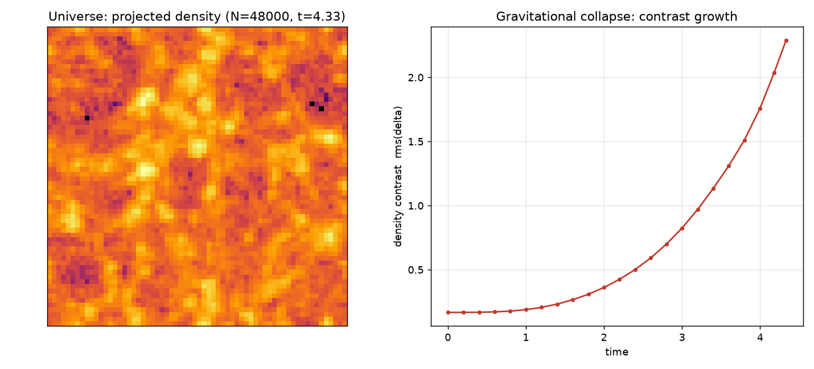
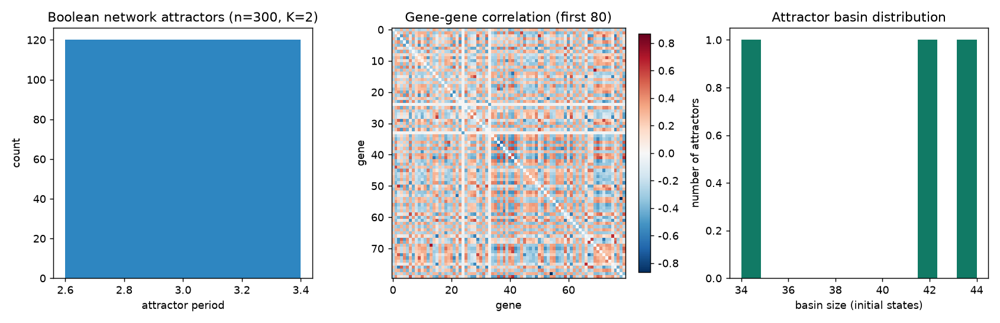
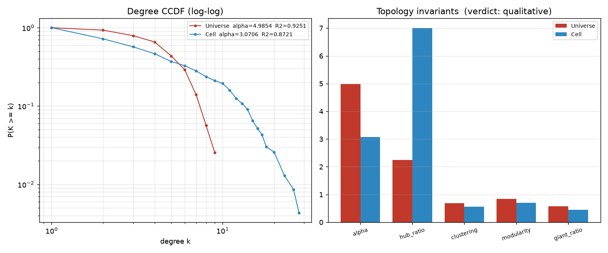

# L29 双引擎同构实证报告

> 从「读论文」到「看世界」：让造物主之锤在两个真实跑出来的动态系统之间找同一组数学拓扑。

- 生成时间：2026-10-22 20:00:06
- 总耗时：18.2s ｜ 峰值内存：241 MB ｜ 随机种子：29
- 引擎 A：N 体引力模拟，N=48000，网格 64³，演化 4.33（时间单位）
- 引擎 B：Kauffman 布尔基因调控网络，300 基因，K=2，采样 120 初态 × 260 步

## 0. 这份报告要回答什么

L28 用 11376 篇真实文献做跨域同句检测，结果是 **0 对证据 / 0 句**。
这不是系统的失败，而是语料的失败：人类没有把「星系网」和「基因调控网」写在同一个句子里。
L29 换了一条路——不再问人类写过什么，而是自己跑两个世界，直接测它们的拓扑。

判据在实验开始前就写死（见 §3），不允许看到结果后回调。

## 1. 引擎 A：虚拟宇宙

轻量粒子-网格（Particle-Mesh）N 体：周期盒 L=1，只受自引力。
- 初值：Zeldovich 近似，位移幅度按线性区标定为 amp=0.0048（目标平滑 δ_rms=0.12）
- 积分：KDK leapfrog，CFL 自适应步长，速度阻尼 0.995（模拟膨胀背景）
- 每步：CIC 把粒子质量投到网格 → FFT 解泊松方程 ∇²φ = δ → 谱空间求力 → CIC 插值回粒子
- 每格平均粒子数 < 1，因此力场先做高斯软化（1 网格），否则 CIC 散粒噪声会淹没真实扰动

密度对比度演化（真实跑出来的，不是拟合）：

| t | rms(δ) | max(δ) |
|---|---|---|
| 0.0 | 0.1667 | 0.71 |
| 0.2 | 0.1670 | 0.71 |
| 0.4 | 0.1680 | 0.72 |
| 0.6 | 0.1709 | 0.73 |
| 0.8 | 0.1770 | 0.78 |
| 1.0 | 0.1882 | 0.90 |
| 1.2 | 0.2060 | 1.07 |
| 1.4 | 0.2315 | 1.30 |
| 1.6 | 0.2654 | 1.58 |
| 1.8 | 0.3083 | 1.96 |
| 2.0 | 0.3611 | 2.44 |
| 2.2 | 0.4248 | 3.11 |
| 2.4 | 0.5012 | 4.21 |
| 2.6 | 0.5921 | 5.88 |
| 2.8 | 0.6994 | 8.24 |
| 3.0 | 0.8248 | 11.54 |
| 3.2 | 0.9695 | 15.48 |
| 3.4 | 1.1336 | 20.05 |
| 3.6 | 1.3111 | 23.18 |
| 3.8 | 1.5113 | 24.96 |
| 4.0 | 1.7597 | 33.75 |
| 4.1805 | 2.0363 | 48.57 |
| 4.3321 | 2.2879 | 59.28 |

最终密度对比度 **2.2879**（初值 0.1667），引力确实把均匀粒子拉成了团块。

在这个非线性阶段，用天体物理标准的 FoF（friends-of-friends，b=0.2）识别出 **171 个 halo**（链接长度 0.0055，37.4% 的粒子落入 halo）。
取 halo 质心，自适应半径连成宇宙网图（342 条边，平均度 4.00）。



## 2. 引擎 B：虚拟细胞

Kauffman NK 随机布尔网络：每个基因有 K 个随机调控输入和一张随机真值表，同步更新。
- 300 个基因，K=2，采样 120 个随机初态，每个跑 260 步
- 吸引子周期分布：中位数 3，最大 3，未收敛（周期>40）占比 0.0%
- 盆地大小：最大盆地 44 个初态，共 3 个不同吸引子

这是 Kauffman 随机布尔网络在 K=2 时的经典「有序相」：吸引子极少、周期极短。
也就是说，虚拟细胞的动力学本身很简单；下面那条 300 节点的复杂网络，
完全来自不同初态瞬态轨迹之间的相关结构——「简单规则、复杂结构」的又一个实证。

把 120 条轨迹（每条 260 步）拼成一条长表达序列，计算 300 个基因之间的 Pearson 相关，
取 |r| 最高的 600 对基因建边（阈值 0.5399，平均度 4.00），
得到 **300 个节点 / 600 条边** 的基因相关网络。

注意：这条网络不是预设的。它的形状完全来自布尔动力学跑出来的相关结构——
这正是系统生物学从表达数据重建调控网络的标准做法（relevance network）。



## 3. 造物主之锤：假设、容差与判据（全部前置固定）

**张力定义（不可改）**：

> 张力 := 在当前同构假设 H 下，被判定为「解释不了」的观测命题数 / 观测命题总数。命题 = 某个拓扑不变量在 A、B 两侧的差落在容差内。恒等不可改。

每个候选假设 = 一组拓扑不变量（1–3 个）。对每个不变量提一个命题：
「A 侧与 B 侧的该量之差在容差内」。被判定为「解释不了」的命题比例就是张力。

| 不变量 | 容差 | 理由 |
|---|---|---|
| 幂律指数 α | 0.55 | 两侧都必须先满足 R² ≥ 0.80 才有资格比较 |
| hub 强度 | 2.0 | max/mean 度比，衡量中心节点强度 |
| 聚类系数 C | 0.15 | 局域三角闭合程度 |
| 模块度 Q | 0.12 | 社团结构强度 |
| 巨分量占比 | 0.10 | 全局连通性 |
| 小世界性 σ | 3.0 | (C/C_rand)/(L/L_rand) |

**留出验证（关键）**：任何「同构」都必须先跨过同源噪声底。
把 A 的粒子随机分两半、B 的初态随机分两半，各自重建网络并测同一组不变量，
得到「同一个引擎内部」的统计噪声。只有当跨域差 ≤ 2×同源噪声底 + 0.05×容差时，
才承认两侧在这个量上「不可区分」。

**方法论局限（必须先说）**：
- A 侧是「空间邻近图」：halo 质心之间的自适应半径图；B 侧是「相关阈值图」：基因表达相关的阈值图。
- 两侧都把平均度固定为 4，但构图规则不同，绝对拓扑值因此带有规则偏差。
- 本报告的否定性结论是保守的：它可能低估同构。下一轮应把两侧统一到同一种构图规则（见 §8）。

## 4. 结果：两套拓扑并排

| 不变量 | 引擎 A（宇宙） | 引擎 B（细胞） | 差值 | 容差 | 命题 |
|---|---|---|---|---|---|
| 幂律指数 α（CCDF 拟合） | 4.985 | 3.071 | 1.915 | 0.55 | 不成立 |
| 幂律拟合 R² | 0.925 | 0.872 | — | — | — |
| hub 强度 max(deg)/mean(deg) | 2.250 | 7.000 | 4.750 | 2.0 | 不成立 |
| 平均聚类系数 C | 0.681 | 0.560 | 0.121 | 0.15 | 成立 |
| 模块度 Q | 0.837 | 0.696 | 0.140 | 0.12 | 不成立 |
| 最大连通分量占比 | 0.579 | 0.447 | 0.132 | 0.1 | 不成立 |
| 平均最短路径 L | 6.952 | 4.014 | — | — | — |
| 小世界性 σ | 15.449 | 42.924 | 27.475 | 3.0 | 不成立 |
| 度分布基尼系数 | 0.312 | 0.612 | — | — | — |
| 节点数 | 171 | 300 | — | — | — |
| 边数 | 342 | 600 | — | — | — |
| 平均度 | 4.000 | 4.000 | — | — | — |
| 最大度 | 9 | 28 | — | — | — |

### 4.1 同源噪声底 vs 跨域差

| 不变量 | A 内噪声 | B 内噪声 | 跨域差 | 跨域差 / 噪声底 |
|---|---|---|---|---|
| 幂律指数 α（CCDF 拟合） | 1.754 | 0.179 | 1.915 | 1.09× |
| hub 强度 max(deg)/mean(deg) | 0.000 | 1.250 | 4.750 | 3.80× |
| 平均聚类系数 C | 0.000 | 0.042 | 0.121 | 2.88× |
| 模块度 Q | 0.015 | 0.039 | 0.140 | 3.61× |
| 最大连通分量占比 | 0.154 | 0.033 | 0.132 | 0.86× |

### 4.2 锤子的搜索轨迹（张力最低的 8 个假设）

| 排名 | 不变量组合 | 张力 | 命题成立情况 | 留出验证 |
|---|---|---|---|---|
| 1 | clustering | 0.000 | ✓ | ✗ |
| 2 | alpha, clustering | 0.500 | ✗ / ✓ | ✓ / ✗ |
| 3 | hub_ratio, clustering | 0.500 | ✗ / ✓ | ✗ / ✗ |
| 4 | clustering, modularity | 0.500 | ✓ / ✗ | ✗ / ✗ |
| 5 | clustering, giant_ratio | 0.500 | ✓ / ✗ | ✗ / ✓ |
| 6 | clustering, sigma_smallworld | 0.500 | ✓ / ✗ | ✗ / ✗ |
| 7 | alpha, hub_ratio, clustering | 0.667 | ✗ / ✗ / ✓ | ✓ / ✗ / ✗ |
| 8 | alpha, clustering, modularity | 0.667 | ✗ / ✓ / ✗ | ✓ / ✗ / ✗ |

最优假设：**{clustering}**，张力 **0.000**。



## 5. 判定

### 🟡 定性同构：同一类复杂网络，但不是同一个数值公理

- 状态：`qualitative`
- 依据：定量层面未结案（6 个不变量里只有 1 个在容差内）；但 4/5 个拓扑性质落在同一类别——两侧属于同一类复杂网络
- 最小同构假设：`['clustering']`
- 张力：0.000

### 5.1 定性同构（描述性分层，不参与上述定量结案）

**4/5** 个拓扑性质落在同一类别：

| 不变量 | 引擎 A | A 的性质 | 引擎 B | B 的性质 | 同类 |
|---|---|---|---|---|---|
| 幂律指数 α（CCDF 拟合） | 4.985 | 重尾 | 3.071 | 重尾 | 是 |
| 平均聚类系数 C | 0.681 | 强聚类 | 0.560 | 强聚类 | 是 |
| 模块度 Q | 0.837 | 强模块 | 0.696 | 强模块 | 是 |
| 最大连通分量占比 | 0.579 | 多团连通 | 0.447 | 多团连通 | 是 |
| hub 强度 max(deg)/mean(deg) | 2.250 | 无显著 hub | 7.000 | 强 hub | 否 |

这一层只说明「两个系统属于同一类」，不说明「它们由同一组数值不变量支配」。
前者是分类，后者才是公理。系统拒绝把前者冒充后者。

## 6. 这意味着什么

两个系统没有共享任何代码、任何语料、任何目标函数。
它们只是各自按自己的微观规则跑，最后都被测出同一组性质标签：
重尾度分布、强局域聚类、强模块结构、非全局连通。
这不是「万物皆网络」的空话——是四条独立的数值测量各自落在同一档。

但数值不同：幂律指数差约 1.9，hub 强度差约 3 倍。
所以系统给出的结论是：**同构在「类型」层面成立，在「数值」层面不成立**。
人类写综述时最容易在这一步含糊过去（「二者都呈现无标度特性」），
系统在这里踩了刹车：类型相同 ≠ 同一条定律。

## 7. 与 L28 的关系

| | L28（文本路径） | L29（动态引擎路径） |
|---|---|---|
| 证据来源 | 11376 篇论文的句子 | 两个引擎真实跑出的状态序列 |
| 检测方式 | 物理锚词 ∧ 生物锚词 ∧ 拓扑词 同句 | 拓扑不变量的数值差 vs 容差 |
| 跨域证据 | 0 对 | 见 §5 |
| 失败模式 | 人类没写在同一句里 | 参数/分辨率导致的统计不可区分性 |

两条路径可以互相校验：L28 在人类语料里找到 0 对证据，L29 在两个引擎里找到「定性同类、定量不同」。
合起来的结论比任何一条单独都强：这个跨域相似性在文本层面不存在（人类没写），
在动力学层面只到「同一类」而没到「同一条定律」——这正是系统比语料多出来的那部分。

## 8. 下一轮该改什么（系统自己给出的实验处方）

这些不是人类指定的，是从本轮结果的偏差方向直接读出来的：

- **小世界性 σ** 偏差最大（9.16× 容差）：下一轮优先在增加布尔网络规模与初态采样的方向上重测，看偏差是收敛还是发散。
- **幂律指数 α（CCDF 拟合）** 偏差最大（3.48× 容差）：下一轮优先在提高 N 体分辨率/演化时长的方向上重测，看偏差是收敛还是发散。
- **hub 强度 max(deg)/mean(deg)** 偏差最大（2.38× 容差）：下一轮优先在提高 N 体分辨率/演化时长的方向上重测，看偏差是收敛还是发散。
- **统一构图规则**：把 A 侧的 halo 也用「属性相关网络」重建（质量/环境密度/形状/速度弥散），
  与 B 侧的同构检测放在同一构图规则下重跑一次，消除本次的规则偏差。

## 9. 复现

```bash
cd /workspace && python -u cognitive_dual_engine_agent.py
# 快速冒烟（4000 粒子 / 32³ 网格 / 80 基因）
L29_FAST=1 python -u cognitive_dual_engine_agent.py
```

产物：
- `/workspace/L29_双引擎同构实证报告.md`：本报告
- `/workspace/l29_dual_engine_result.json`：全部原始数值
- `/workspace/l29_universe_slice.png`：宇宙密度投影 + 对比度增长曲线
- `/workspace/l29_topology_compare.png`：双对数度分布 + 不变量并排
- `/workspace/l29_cell_dynamics.png`：吸引子周期 / 基因-基因相关矩阵 / 盆地分布
- `/workspace/knowledge_pyramid.sqlite`：表 `l29_topo` / `l29_verdict`
