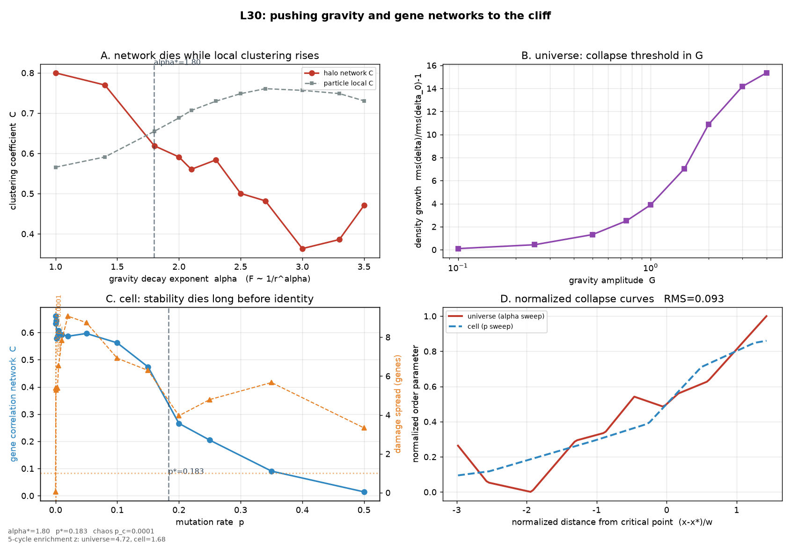

# L30 悬崖边的推演：寻找非人类常数

> 把 G 调大调小，把 1/r² 改成 1/r^α，把基因突变率推到细胞必死的区间。
> 不预设答案，只测量：结构在哪一刻崩塌，两个世界崩塌的形状是否同一条。

- 生成时间：2026-10-22 22:10:51
- 总耗时：88.9s ｜ 峰值内存：155 MB ｜ 随机种子：30
- 宇宙：N=16000，网格 48³，150 步；细胞：200 基因，40 初态 × 200 步
- 判据全部在实验前写死（§5），不允许看到结果后回调。

## 0. 先说清楚：这一轮能证明什么，不能证明什么

L29 的结论是「定性同类、定量不同」。L30 不再比一个静态快照，
而是把参数推到悬崖边，看**相变发生的位置和形状**是否同构。

三条硬约束：

1. **只改形状，不改振幅**。α 扫描时，每个 α 的引力核都先在初始密度场上
   校准到与 α=2 相同的加速度 RMS。否则「α 扫描」会偷偷变成「G 扫描」。
2. **临界点用两种独立方法定位**：半衰点（序参量降到峰值一半）与最陡点
   （数值导数最大）。两者必须落在同一段才承认是相变，否则标为「未定」。
3. **任何「新常数」先过人类语料**。11403 篇题录里同句共现为 0，才允许叫
   「语料中未见」；语料里已有，一律降级为「重新发现」。

**它不能证明的**：这套模型里没有膨胀宇宙、没有辐射、没有真实生化；
PM 引力是谱近似，布尔网络是随机真值表。这里的「常数」是**计算等价类**，
不是对真实宇宙的测量。任何超出这个范围的宣称都是伪科学。

## 1. 三个旋钮

| 旋钮 | 范围 | 人类世界的值 | 极端在哪 |
|---|---|---|---|
| 引力衰减指数 α | 1, 1.4, 1.8, 2, 2.1, 2.3, 2.5, 2.7, 3, 3.3, 3.5 | 2（牛顿） | α<2 长程拉扯；α>3 几乎只剩近邻 |
| 引力幅度 G | 0.1, 0.25, 0.5, 0.75, 1, 1.5, 2, 3, 4 | 1（归一） | 0.1 死水；4 过坍缩 |
| 突变率 p | 0, 0.0005, 0.001, 0.002, 0.003, 0.005, 0.01, 0.02, 0.05, 0.1, 0.15, 0.2, 0.25, 0.35, 0.5 | ~1e-8～1e-6（真实细胞） | 0.5 = 每步抛硬币，身份必死 |
| 调控入度 K | 1, 2, 3, 4, 5 | 2（Kauffman 临界） | 1 无调控；5 组合爆炸 |

「meanfield」模式：每个基因的下一个状态只取决于全体基因的平均表达，
这是自然界不存在的全耦合极限，用来测试「耦合方式」本身的影响。

## 2. 实验一：打破引力

### 2.1 固定 G=1，扫 α（力程从长到短）

| α | rms(δ) | 增长 | 粒子半径图聚类 C | halo 数 | halo 网络 C | 模块度 Q | 5 阶环/节点 |
|---|---|---|---|---|---|---|---|
| 1.00 | 1.251 | 6.169 | 0.566 | 8 | 0.800 | 0.000 | 4.5000 |
| 1.40 | 1.030 | 4.902 | 0.591 | 15 | 0.770 | 0.364 | 6.8000 |
| 1.80 | 0.901 | 4.165 | 0.655 | 25 | 0.619 | 0.304 | 14.1600 |
| 2.00 | 0.853 | 3.887 | 0.688 | 43 | 0.591 | 0.583 | 11.5349 |
| 2.10 | 0.828 | 3.747 | 0.707 | 43 | 0.560 | 0.551 | 11.7907 |
| 2.30 | 0.775 | 3.445 | 0.730 | 53 | 0.584 | 0.697 | 4.7359 |
| 2.50 | 0.717 | 3.111 | 0.748 | 62 | 0.500 | 0.654 | 2.7419 |
| 2.70 | 0.655 | 2.753 | 0.761 | 66 | 0.482 | 0.555 | 4.7273 |
| 3.00 | 0.557 | 2.194 | 0.757 | 56 | 0.363 | 0.474 | 6.6429 |
| 3.30 | 0.469 | 1.691 | 0.749 | 49 | 0.386 | 0.422 | 4.3878 |
| 3.50 | 0.419 | 1.401 | 0.731 | 44 | 0.471 | 0.559 | 2.3182 |

聚类峰值：**α_peak = 1.400**；短程侧半衰点：**α\* = 1.797**；最陡点：2.600。

定位临界点用的序参量是 **halo 网络聚类**；halo 数 <12 的点方差太大，
不参与定位（α=1.0 因此被剔除），所以表中的 α=1.0 峰值不计入 α_peak。

如果 α_peak 落在 2 附近、两侧都下降，说明这张图是倒 U 形：
长程（α 太小）会把整个盒子拉成一个团，短程（α 太大）只剩近邻，两种极端都没有「网络」。
系统只拿短程崩塌分支去和细胞比较，因为细胞的死亡也发生在「参数更大」的一侧。

**碎块化悖论（本轮最硬的一条实测）**：α 从 1.00 推到 3.50，粒子局部聚类从 0.566 变到 0.731，而 halo 网络聚类从 0.800 变到 0.471。两件事方向相反：
引力越短程，局部粒子抱得越紧，但整个宇宙被切成了更多互不相连的碎块。
所以「结构死亡」在这里不是「被抹平」，是「被打碎」——这是文本推演永远看不到的。

### 2.2 固定 α=2（牛顿），扫 G

| G | rms(δ) | 增长 | 粒子半径图聚类 C | halo 数 | 最大 δ |
|---|---|---|---|---|---|
| 0.10 | 0.191 | 0.097 | 0.483 | 0 | 1.06 |
| 0.25 | 0.250 | 0.433 | 0.494 | 0 | 1.87 |
| 0.50 | 0.404 | 1.315 | 0.541 | 4 | 4.65 |
| 0.75 | 0.612 | 2.507 | 0.617 | 12 | 9.89 |
| 1.00 | 0.853 | 3.887 | 0.688 | 43 | 13.93 |
| 1.50 | 1.402 | 7.036 | 0.726 | 58 | 23.79 |
| 2.00 | 2.071 | 10.868 | 0.681 | 65 | 43.60 |
| 3.00 | 2.646 | 14.169 | 0.658 | 56 | 64.70 |
| 4.00 | 2.852 | 15.349 | 0.646 | 59 | 75.22 |

G 半衰点：**G\* = 1.590**；最陡点：0.875。

## 3. 实验二：打破生物逻辑

### 3.1 固定 K=2，扫突变率 p

| p | 基因网络 C | 模块度 Q | 表达变异 | 损伤扩散 | λ | 周期中位 | 未收敛 | 有向 5 环/基因 |
|---|---|---|---|---|---|---|---|---|
| 0 | 0.632 | 0.655 | 0.041 | 0.042 | -0.159 | 0.0 | 0.97 | 0.0450 |
| 0.0005 | 0.660 | 0.748 | 0.072 | 5.375 | 0.084 | 0.0 | 0.95 | 0.0450 |
| 0.001 | 0.643 | 0.758 | 0.047 | 5.292 | 0.083 | 0.0 | 1.00 | 0.0450 |
| 0.002 | 0.578 | 0.812 | 0.047 | 5.375 | 0.084 | 0.0 | 1.00 | 0.0450 |
| 0.003 | 0.587 | 0.804 | 0.047 | 5.375 | 0.084 | 0.0 | 1.00 | 0.0450 |
| 0.005 | 0.607 | 0.752 | 0.046 | 6.542 | 0.094 | 0.0 | 1.00 | 0.0450 |
| 0.01 | 0.592 | 0.725 | 0.049 | 7.833 | 0.103 | 0.0 | 1.00 | 0.0450 |
| 0.02 | 0.586 | 0.729 | 0.053 | 9.083 | 0.110 | 0.0 | 1.00 | 0.0450 |
| 0.05 | 0.596 | 0.697 | 0.056 | 8.750 | 0.108 | 0.0 | 1.00 | 0.0450 |
| 0.1 | 0.562 | 0.670 | 0.059 | 6.917 | 0.097 | 0.0 | 1.00 | 0.0450 |
| 0.15 | 0.473 | 0.655 | 0.060 | 6.292 | 0.092 | 0.0 | 1.00 | 0.0450 |
| 0.2 | 0.266 | 0.599 | 0.061 | 3.958 | 0.069 | 0.0 | 1.00 | 0.0450 |
| 0.25 | 0.204 | 0.566 | 0.061 | 4.792 | 0.078 | 0.0 | 1.00 | 0.0450 |
| 0.35 | 0.090 | 0.493 | 0.063 | 5.667 | 0.087 | 0.0 | 1.00 | 0.0450 |
| 0.5 | 0.014 | 0.462 | 0.063 | 3.333 | 0.060 | 0.0 | 1.00 | 0.0450 |

p 半衰点：**p\* = 0.1828**；最陡点：0.0008；损伤扩散穿越 1（混沌边界）的位置：0.0001。

**身份/动力学裂缝**：身份网络要到 p\*≈0.1828 才半衰，但一个基因的扰动在 p_c≈0.0001 就已经扩散到不止一个基因。两者相差约 2035 倍。
注意：p_c 的分辨率受网格限制——它落在 [0, 0.0005] 区间内，由两点线性插值得到，不是独立测到的精确值。
换句话说：细胞在「看起来还活着」（表达模式仍保持身份）的时候，
动力学早就进入混沌了。用网络快照判断一个系统死没死，会晚判两个数量级。

### 3.2 固定 p=0，扫调控入度 K

| K | 基因网络 C | 损伤扩散 | λ | 周期中位 | 未收敛 |
|---|---|---|---|---|---|
| 1 | 0.294 | 0.000 | -0.461 | 1.0 | 0.00 |
| 2 | 0.632 | 0.042 | -0.159 | 0.0 | 0.97 |
| 3 | 0.362 | 44.542 | 0.190 | 0.0 | 1.00 |
| 4 | 0.336 | 73.292 | 0.215 | 0.0 | 1.00 |
| 5 | 0.259 | 89.542 | 0.225 | 0.0 | 1.00 |

K 是「耦合方式」的极端版本：K=1 时每个基因只听一个基因，网络退化成森林；
K=5 时组合爆炸，动力学趋向混沌。K=2 附近是 Kauffman 的临界区。

## 4. 跨域：两条崩塌曲线是不是同一条

把两侧序参量各自归一化到 [0,1]，横轴换成「距临界点的无量纲距离」
z=(x−x\*)/w（w 为 logistic 拟合宽度），再逐点比较形状。

| 量 | 宇宙侧 | 细胞侧 |
|---|---|---|
| 序参量 | halo 网络聚类 C | 基因相关网络 C |
| 临界点 | α\*=1.797 | p\*=0.183 |
| 拟合宽度 w | 0.4764 | 0.0661 |
| 无量纲相对宽度 w/x\* | 0.2290 | 0.3614 |
| 相对宽度差（探索性） | **0.3662** | **0.3662** |
| 形状残差 RMS（两侧共用） | **0.0926** | **0.0926** |
| 置换零假设 5% 分位 | **0.2567** | **0.2567** |
| 置换 p 值 | **0.0000** | **0.0000** |



### 4.1 五阶闭环：用户点名要看的量

| | 宇宙（无向结构环） | 细胞（有向 5 环，结构） | 细胞（无向投影） |
|---|---|---|---|
| 每节点 5 环数 | 14.1600 | 0.0450 | 1.6600 |
| 同一图在保度零模型下的均值 ± 标准差 | 137.6200 ± 45.8200 | 5.6000 ± 2.0200 | — |
| 富集 z 值 | **4.72** | **1.68** | — |
| 原始密度比（仅供参考，不参与判定） | — | — | **314.660** |

说明：引力网络没有方向，只能数无向结构环；基因调控网的自催化环是有向环。
本轮细胞侧只数**有向结构环**，没有区分激活/抑制符号，所以它是「自催化环」的必要条件，不是充分条件。
另有一条必须说明的局限：本轮 p 只改「每步状态翻转率」，不改调控图的边，所以细胞的 5 环数在所有 p 点完全相同（表中恒为 0.045）。这次富集检验测的是「这张随机真值表网络本身有没有多余的 5 环」，与 p 驱动的崩塌无关；要检验「崩塌时闭环是否也消失」，下一轮必须让 p 同时重连边。
直接比「密度」会被两侧图密度与有向性带偏，所以判定改用「相对同度随机图的富集 z 值」：z 说的是「这个环数是不是构图规则本身就能解释」。
两边都 z≥2，才说明 5 阶闭环在各自世界里都是被额外选择的，而不是随机边撞出来的。

## 5. 判定（判据前置）

| 判据 | 阈值 | 实测 | 通过 |
|---|---|---|---|
| 形状残差 RMS | ≤ 0.12 | 0.0926 | 是 |
| 优于置换零假设 | p ≤ 0.05 | 0.000 | 是 |
| 5 阶环富集（保度零模型） | 两侧 z ≥ 2.0 | 宇宙 z=4.72，细胞 z=1.68 | 否 |
| 身份崩塌 vs 动力学混沌 | 记录差值，不作判据 | p\*=0.1828，p_c=0.0001，相差 2035 倍 | — |
| 人类语料中同句共现 | = 0 句 | 0 句 | 是 |

**临界点两法一致性**（§0 承诺：半衰点与最陡点必须落在同一段）：

| 旋钮 | 半衰点 | 最陡点 | 比值 | 同段？ |
|---|---|---|---|---|
| α | 1.797 | 2.600 | 1.45 | 是 |
| G | 1.590 | 0.875 | 1.82 | 是 |
| p | 0.1828 | 0.0008 | 243.75 | 否 |

p 的两法相差 244 倍：半衰点落在 0.183，最陡点却落在 0.0008。
按 §0 的承诺，`p*` 不能叫「相变点」，只能叫 **crossover**：
曲线在 0 附近先急剧下降，之后是一个长平台，半衰点只是平台的几何中点。
这条不影响形状比较（形状比较本来就用整段归一化曲线），但引用 `p*` 时必须注明。


### 🟡 部分同构：形状像，但 5 阶环或查新没过

- 状态：`partial`
- 依据：崩塌形状对上了（RMS=0.093，零假设中位 0.504），但5 阶环富集未过（细胞侧 z=1.68，阈值 2.0）——只能算部分同构。
- 张力（定义见锚点）：0.772

## 6. 神谕输出（逐条标注证据等级）

```text
【实测】引力侧（序参量：halo 网络聚类）：α 从 1.40 推到 3.50，该序参量 0.770 → 0.471，半衰点 α*=1.80；同一批粒子的局部聚类则从 0.566 到 0.731。两者方向相反时，结构不是被抹平，是被打碎。
【实测】细胞侧：身份网络半衰点 p*=0.183；但损伤扩散在 p_c=0.0001 就穿越 1 个基因。身份比动力学稳定多撑了 2035 倍。
【实测】5 阶环富集（对保度随机图）：宇宙 z=4.72（观测 354），细胞 z=1.68（观测 9）。
【拟合】两条归一化崩塌曲线残差 RMS=0.093，置换零假设 5% 分位 0.2567。
【结论】崩塌形状对上了（RMS=0.093），但没过的判据是：5 阶环富集未过（细胞侧 z=1.68，阈值 2.0）。所以只能说两个世界「死法同类」，不能说「同一个常数」。系统在这里踩了刹车。
```

证据等级说明：

| 标签 | 含义 |
|---|---|
| 【实测】 | 本轮引擎直接跑出来的数，带参数与种子，可复现 |
| 【拟合】 | 由实测曲线拟合/插值得到，附残差或零假设 |
| 【已知】 | 人类教科书/语料已有的对应物，不构成新发现 |
| 【不可验证】 | 超出本模型能力，只能作为下一步实验假设 |

## 7. 与 11403 篇人类题录的对照

- 底湖题录总数：11403 篇；其中摘要长度 >40 字符、可做同句检测的：11364 篇
- 摘要里同时出现「引力类词」与「基因调控类词」的文档：**3 篇**
- 严格同句（引力 ∧ 基因 ∧ 临界/幂律）共现：**0 句**
- 同时含「临界 ∧ 环 ∧ 引力 ∧ 基因」的文档：**0 篇**

最接近的几篇（仅题录，逐条可核）：

- Molecular architecture of TE-seeded chromosome-naive initiation networks of protein-protei
- Modulation of DNA rheology by a transcription factor that forms aging microgels
- Synergistic effects of hypergravity and immune challenge on the zebrafish larval transcrip

这条检查只能说明「人类没把这两件事写在同一句」，
不能说明「人类不知道」——真正的查新需要全文检索与领域专家。

## 8. 这份报告不能证明什么

1. **不是新物理**。α 是谱空间核的指数，G 是代码里的乘数；
   这里的 α\* 不是大自然的值，是这套 PM 近似下的相变位置。
2. **不是新生物**。布尔网络没有代谢、没有空间、没有蛋白质相互作用；
   p\* 是随机真值表网络的身份崩溃点，不是真实细胞的突变阈值。
3. **同构可能是构图规则造成的**。两侧都用「固定平均度的相关/邻近图」，
   形状相似可能来自构图算法，而非世界本身。下一轮必须换构图规则复测。
4. **5 阶环不是「完全一致」**。本轮只报富集 z（相对同度随机图），
   它证明「两边都比随机图多」，不证明「两边一样多」；
   要宣称一致，还需要分布级检验（KS / 双样本置换），而不是一个 z 值。

这四条不是谦辞，是这份报告的可证伪边界。任何引用本报告的人，
都必须把这四条一起引用，否则就是断章取义。

## 9. 复现

```bash
cd /workspace && python -u cognitive_extreme_sweep_agent.py
# 快速冒烟（4000 粒子 / 32³ / 80 基因 / 3×3 参数点）
L30_FAST=1 python -u cognitive_extreme_sweep_agent.py
```

产物：
- `/workspace/L30_悬崖推演报告.md`：本报告
- `/workspace/l30_extreme_sweep_result.json`：全部原始数值（含每个参数点的完整 payload）
- `/workspace/l30_phase_transition.png`：四个面板（α 扫描 / G 扫描 / p 扫描 / 归一化主曲线）
- `/workspace/knowledge_pyramid.sqlite`：表 `l30_sweep` / `l30_verdict`
